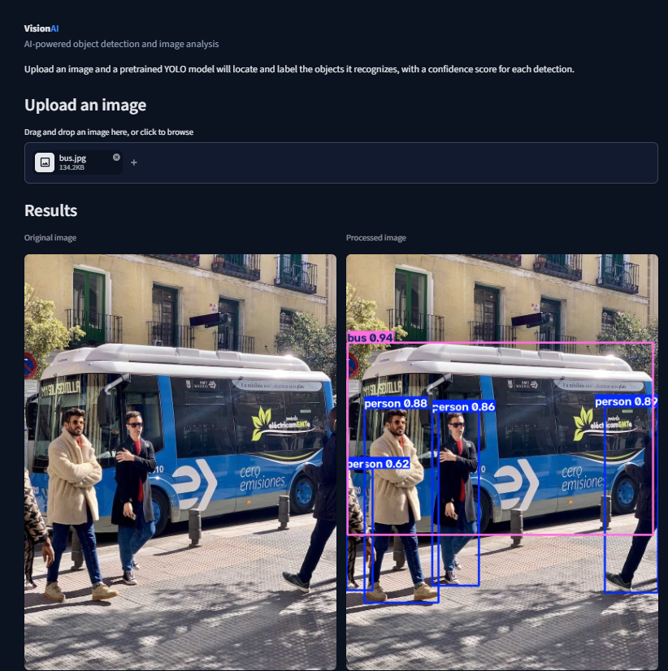
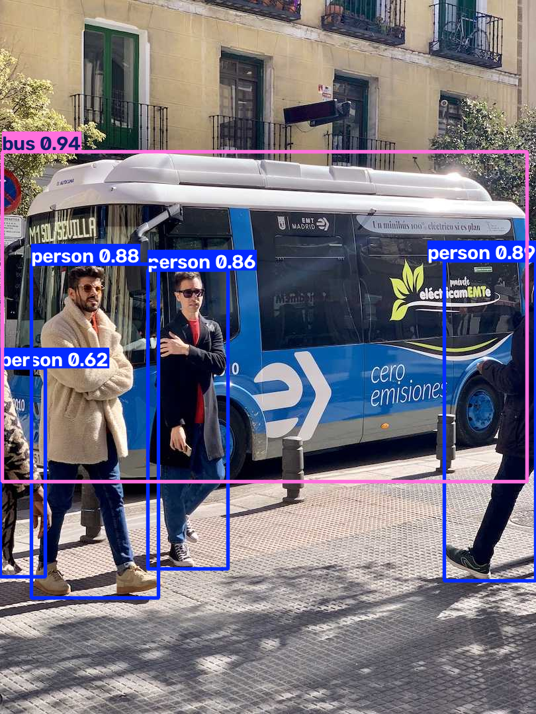

# VisionAI: AI-Powered Object Detection and Image Analysis Platform

A web application that detects and locates everyday objects in images using a pretrained YOLO11 model. Upload an image, adjust the confidence threshold, and get annotated results, per-class statistics, and a downloadable output image.



## Overview

VisionAI wraps a pretrained [Ultralytics](https://github.com/ultralytics/ultralytics) YOLO11n object detector in a clean, modular Python application with a Streamlit interface. The detection logic is separated from the user interface, validated with an automated test suite, and documented so that it can be installed and run from scratch.

## Problem statement

Object detection models are powerful, but using them usually means writing scripts and reading raw output. VisionAI makes a detector accessible to anyone: upload a picture, see what the model finds, how confident it is, and download the annotated result, without writing any code.

## Objectives

- Build a complete, maintainable computer vision application around a pretrained model.
- Keep model logic, helper utilities, and the interface in separate modules.
- Handle invalid input gracefully and verify behaviour with automated tests.
- Document the project so that others can reproduce it.

## Features

- Image upload by drag-and-drop or file browser (JPG, JPEG, PNG, up to 10 MB).
- Validation of file type, size, content, and resolution, with clear error messages.
- Correct handling of phone photos that store rotation in EXIF metadata.
- Object detection with bounding boxes, class labels, and confidence scores.
- Adjustable confidence threshold.
- Results dashboard: original and annotated image, number of objects, number of unique classes, mean confidence, and inference time.
- Detection statistics: bar chart and table by class, plus a table of every individual detection.
- Download of the annotated image as a PNG.

## Technologies

| Area | Tools |
|---|---|
| Language | Python 3 |
| Detection | Ultralytics YOLO11n (pretrained, COCO) on PyTorch |
| Image handling | Pillow, NumPy, OpenCV |
| Interface | Streamlit, pandas |
| Testing | pytest |
| Tooling | Git, GitHub, VS Code |

## Architecture

```
visionai-object-detection/
├── app.py                 # Streamlit interface (layout and user interaction only)
├── detector.py            # ObjectDetector: model loading, inference, annotation
├── utils.py               # Upload validation, statistics, PNG export
├── requirements.txt       # Runtime dependencies
├── requirements-dev.txt   # Runtime + test dependencies
├── pytest.ini             # pytest configuration
├── .streamlit/config.toml # Dark theme and upload limit
├── assets/
│   ├── samples/           # Sample image for trying the app
│   └── screenshots/       # Images used in this README
├── models/                # Model weights (not tracked by Git)
├── tests/
│   ├── test_detector.py   # Model and detection tests
│   └── test_utils.py      # Validation and statistics tests
└── docs/
```

`detector.py` and `utils.py` contain no Streamlit code, so they can be tested and reused independently of the interface. The model is loaded once per server process and cached.

## Installation

Requirements: Python 3 and Git. The project was developed and tested with Python 3.14.7 on Windows.

```powershell
git clone https://github.com/hamzaouisoulayman2006-lang/visionai-object-detection.git
cd visionai-object-detection
python -m venv .venv
.\.venv\Scripts\Activate.ps1
python -m pip install -r requirements.txt
```

On macOS or Linux, activate the environment with `source .venv/bin/activate` instead. These systems have not been tested by the author.

Installing PyTorch makes the first install large (several hundred MB). The app runs on a CPU, so no GPU is needed.

## How to run

```powershell
streamlit run app.py
```

Then open http://localhost:8501. On the first run the YOLO11n weights (about 5 MB) are downloaded automatically. Try the app with `assets/samples/bus.jpg`.

## Example results

With the sample image and the default threshold of 0.25, the model finds 5 objects in 2 classes: 1 bus (confidence 0.94) and 4 persons (confidences between 0.62 and 0.89).

Inference took roughly 0.2 to 0.3 seconds per image in informal runs on the author's CPU laptop. This is not a formal benchmark; speed depends on the hardware and image size.



## Model information

- **Model:** YOLO11n, the smallest model of the Ultralytics YOLO11 family.
- **Training data:** COCO, 80 everyday classes (person, car, bus, dog, chair, and others).
- **Used as-is:** the pretrained weights are not modified or retrained in this project.
- **Confidence score:** a value from 0 to 1 expressing the model's own certainty. It is not a guaranteed probability of being correct.

## Testing

```powershell
python -m pip install -r requirements-dev.txt
python -m pytest -v
```

The suite has 26 test cases covering model loading, detection on a sample image, threshold behaviour, empty results, output image generation, file validation (type, size, corruption, resolution, EXIF rotation), and statistics. The Streamlit interface itself was tested manually and has no automated tests.

## Limitations

- Only the 80 COCO classes can be detected. Other objects are ignored or mislabelled.
- Small, blurred, or partly hidden objects can be missed.
- One image at a time; no video or webcam support yet.
- Tested on Windows with Python 3.14.7 only.
- Inference runs on the CPU; GPU use has not been tested.
- The user interface has no automated tests.

## Future improvements

1. Webcam-based real-time detection.
2. Video file detection.
3. Detection history.
4. More detailed analytics.
5. Comparison of YOLO model sizes.
6. Performance evaluation.
7. Training on a custom dataset.
8. Model evaluation with precision, recall, and mAP.
9. Deployment so that others can use the app online.

## License

This project is released under the GNU Affero General Public License v3.0 (see `LICENSE`), the same licence as the Ultralytics library it builds on. The sample image `bus.jpg` comes from the Ultralytics assets.

## Author

<SOULAYMAN_HAMZAOUI>, Computer Science undergraduate at Harbin Institute of Technology, Shenzhen (HITSZ).
GitHub: [hamzaouisoulayman2006-lang](https://github.com/hamzaouisoulayman2006-lang)